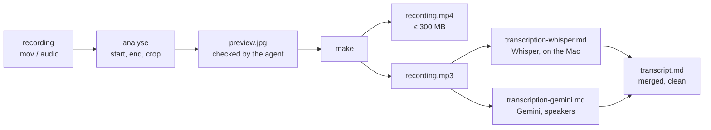

# processing-meeting-recording

After a meeting (an interview, a doctor, any call): its recording becomes a highly compressed video, an MP3 and a clean transcript with the speakers named, in the meeting's folder.

| Command | Does |
|---|---|
| `meeting-recording analyse <recording>` | finds the meeting's start and end (the volume) and the crop (the part of the screen that moves: the faces); draws a preview |
| `meeting-recording make <recording> <folder> <name> --speakers "…"` | makes each missing output in the folder |
| `bash install.sh` / `bash uninstall.sh` | deploy to `~/opt/processing-meeting-recording/` (the skill for every agent, the command on the PATH) / undo |

How an agent uses it, and where each meeting's files go: [`skills/processing-meeting-recording/SKILL.md`](skills/processing-meeting-recording/SKILL.md). Rules and words: [`AGENTS.md`](AGENTS.md).
